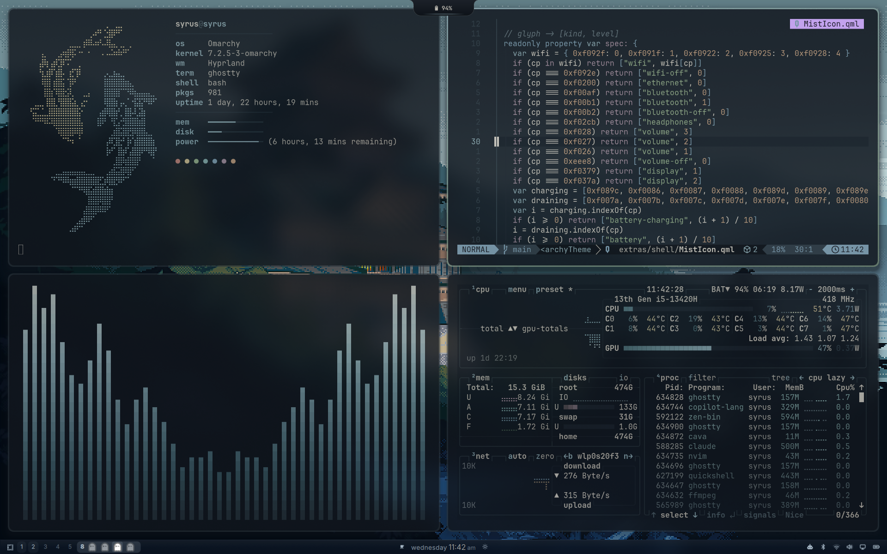
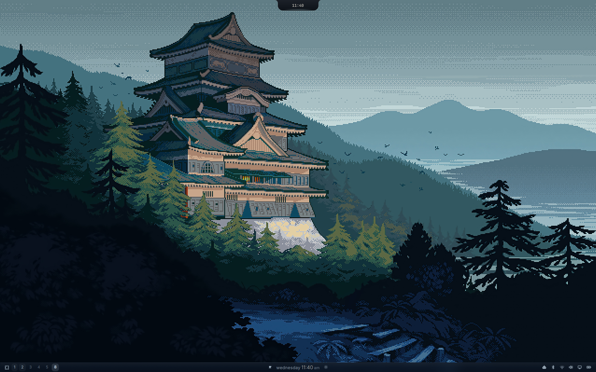
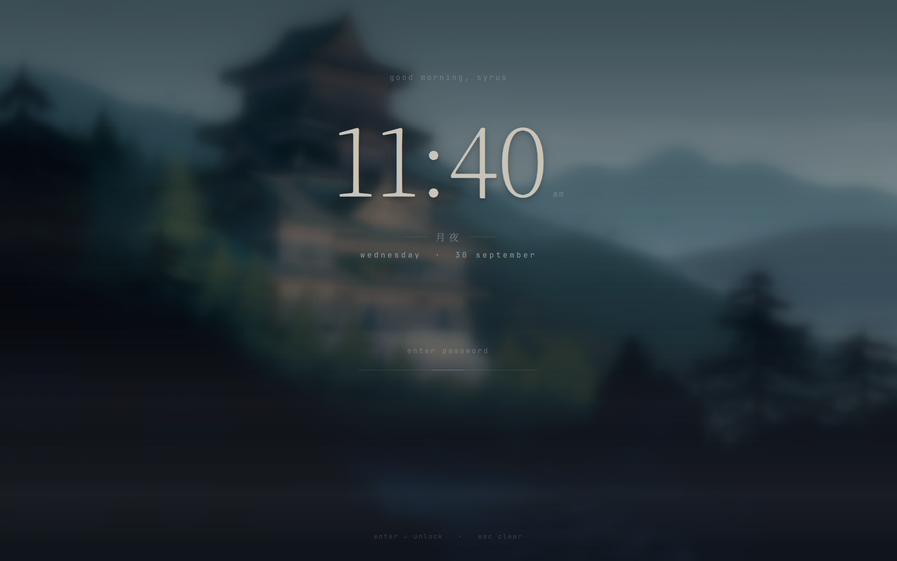
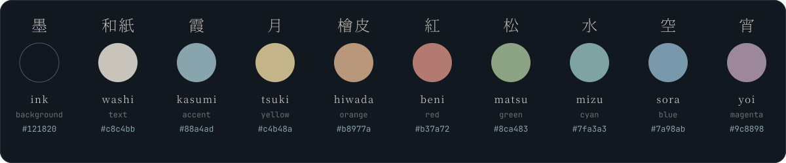
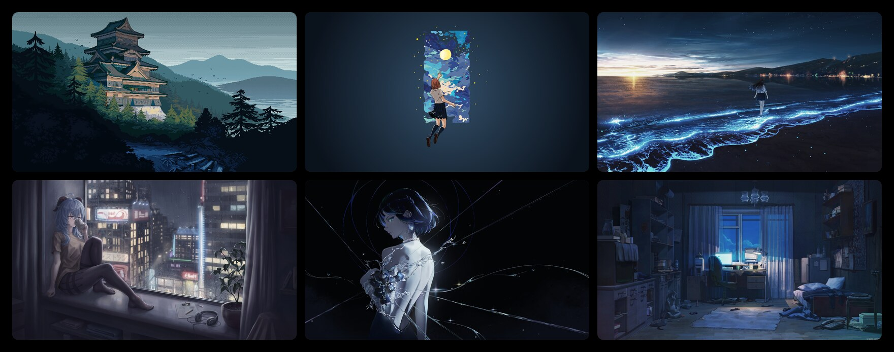

<div align="center">



<br>

<p><a href="#導入--install"></a>&nbsp;<a href="#色--palette"></a>&nbsp;<a href="LICENSE"></a></p>

<b>月の光に、静かな夜を。</b><br>
<sub><i>A quiet night, lit by the moon.</i></sub>

*Tsukiyo* (月夜) means a moonlit night. Blue-teal ink, parchment text, a mist accent, and warm moonlight kept for the small details. Minimal, but crafted down to the lock screen, the bar icons and the koi that greet you in the terminal.

<br>

```bash
omarchy theme install https://github.com/Arjun010011/omarchy-tsukiyo-theme
```

<br>



<sub>fastfetch · Neovim · cava · btop, with the bar below and the Dynamic Island above</sub>

</div>

<br>


## 景 · A look around

<table>
<tr><td>

**机 &nbsp;Desktop**<br>
<sub>The bare desktop: a night-blue glass bar with hand-drawn hairline icons, the Dynamic Island at the top, and the castle the palette was sampled from.</sub>

</td></tr>
<tr><td></td></tr>
<tr><td>

**錠 &nbsp;Lock screen**<br>
<sub>A thin serif clock over the drifting, blurred wallpaper, 月夜 between hairlines, and a single hairline for the password that glints while checking and shakes on a wrong guess.</sub>

</td></tr>
<tr><td></td></tr>
<tr><td>

**起 &nbsp;Boot screen**<br>
<sub>Two koi circling, one in moonlight and one in mist, above 月夜. The same koi swim in fastfetch.</sub>

</td></tr>
<tr><td></td></tr>
</table>


## 趣 · What's inside

| | Part | What it does |
|:-:|---|---|
| **帯** | **Bar** | Full-width night-blue glass, a mist hairline that brightens on hover, Adwaita Sans, and hand-drawn hairline icons for Wi-Fi, Bluetooth, volume, display and battery that follow signal, volume and charge. |
| **島** | **Dynamic Island** | [omarchy-dynamic-island](https://github.com/Arjun010011/omarchy-dynamic-island): a notch for music, notifications, timers and system popups, drawn in the theme's colours. |
| **錠** | **Lock screen** | Drifting blurred wallpaper, three fog bands, a thin serif clock and a hairline password field. |
| **鯉** | **Koi** | Two koi in moonlight and mist, in fastfetch and on the boot screen. |
| **動** | **Motion** | Eased pop-in windows, slide-fade workspaces, a mist-to-pine border that lights on focus, and a faint veil over unfocused windows. |
| **筆** | **Editors & apps** | Hand-tuned Neovim, btop and terminals; Zed, opencode, Zen browser, fish and Tide, tmux, cava, starship, lazygit, yazi and GTK apps. |


## 導入 · Install

**一 &nbsp;The theme.** Everything Omarchy themes itself: Hyprland, the shell (bar, menus,
notifications, popups), terminals, Neovim, btop, VS Code, Chromium, Helix, Obsidian and more.

```bash
omarchy theme install https://github.com/Arjun010011/omarchy-tsukiyo-theme
```

**二 &nbsp;The rest of the desktop, in one step.** The lock screen, bar, Dynamic Island, koi and
every app listed above. Each file it replaces is backed up first; it never installs
packages and never changes your cursor or icon theme.

```bash
~/.config/omarchy/themes/tsukiyo/install-extras.sh           # install
~/.config/omarchy/themes/tsukiyo/install-extras.sh --remove  # undo it all
```

<sub>Omarchy drops a cloned theme's `.lua` files, so this also adds a small loader that brings
back Tsukiyo's Hyprland motion and Neovim colours, only while Tsukiyo is the active theme.</sub>

**三 &nbsp;The boot screen.** The koi on the disk-unlock screen:

```bash
omarchy plymouth set by theme tsukiyo
```


## 色 · Palette



<sub>Mist is the only colour in the chrome. The warm tones (moon, cypress bark, lantern red) are kept for code and for the moments that need your attention.</sub>


## 壁紙 · Wallpapers



Six anime and illustrated night scenes, each scaled to 4K and colour-graded into the
palette. Pick one with the background switcher.

| | Wallpaper | Artist |
|:-:|---|---|
| 1 | Castle in the pines (pixel art) | Artist unknown |
| 2 | Reaching for the moon | [Ands Mahardika on Unsplash](https://unsplash.com/illustrations/girl-reaches-for-the-moon-in-a-dreamy-night-sky--ZVXDrYaN8o), paper recoloured to a night-blue glow and widened to 16:9 |
| 3 | Glowing shore (ブルーな気持ち) | [周憂 on pixiv](https://www.pixiv.net/en/artworks/94171738) |
| 4 | City window, rainy night | [Storm on pixiv](https://www.pixiv.net/en/artworks/92874601) |
| 5 | Starlit (夜蘭) | [J17_eggs on pixiv](https://www.pixiv.net/en/artworks/103243240) |
| 6 | Moonlit room | [ArseniXC on ArtStation](https://www.artstation.com/arsenixc) |

<sub>Image 2 is used under the [Unsplash License](https://unsplash.com/license). The others belong to their artists and are included as fan tribute, with credit; if one is yours and you would like it removed, open an issue and it will be taken out.</sub>


<div align="center">

<sub>月夜 · made with care by <a href="https://github.com/Arjun010011">Arjun010011</a> · MIT</sub>

</div>
