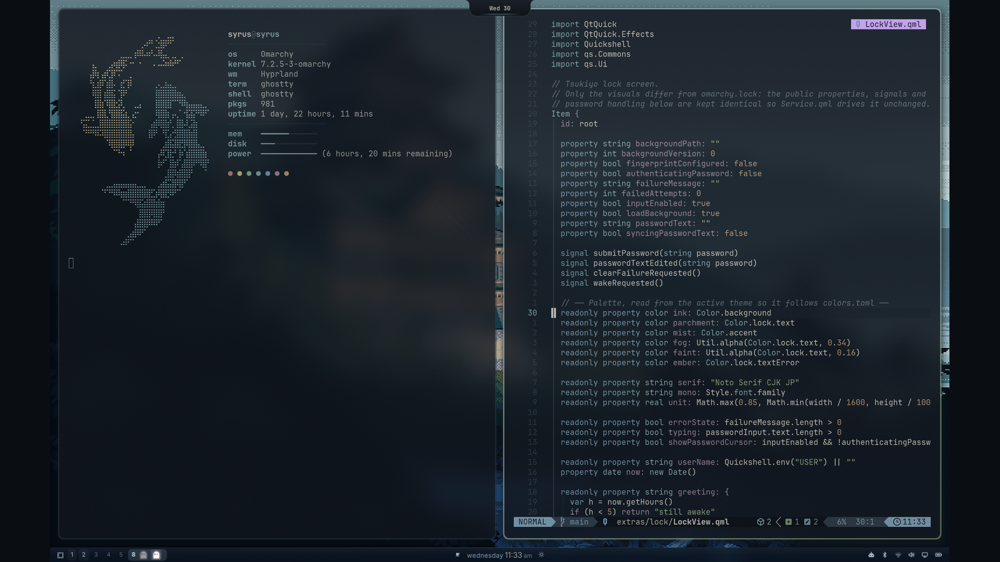
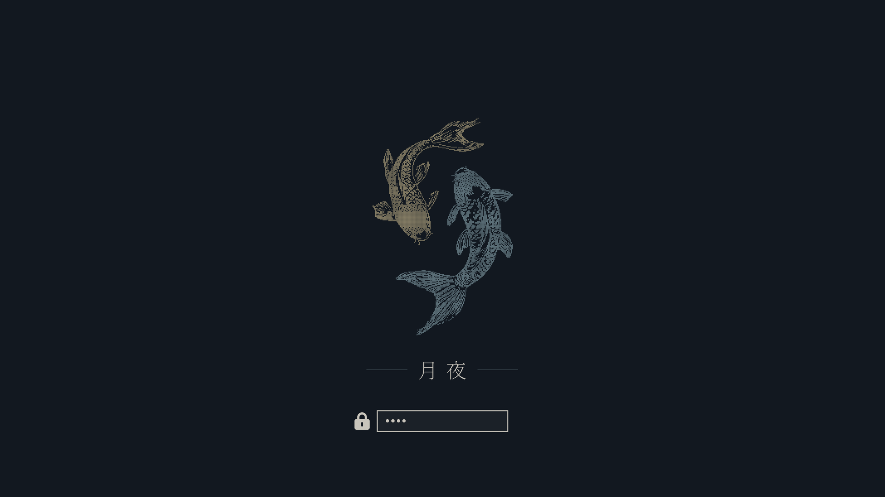

# Tsukiyo 月夜 for Omarchy



*Tsukiyo* means a moonlit night. A calm, dark Omarchy theme: blue-teal ink, parchment
text, a mist-slate accent, and warm moonlight kept for the small details. Minimal, but
crafted down to the lock screen and the bar icons.

## Install

```bash
omarchy theme install https://github.com/Arjun010011/omarchy-tsukiyo-theme
```

That themes everything Omarchy knows about: Hyprland borders, the shell (bar,
menus, notifications, popups), terminals, Neovim, btop, VS Code, Chromium,
Helix, Obsidian and more.

### Everything else, in one step

```bash
~/.config/omarchy/themes/tsukiyo/install-extras.sh
```

This switches the rest of the desktop over, with no manual steps:

- **Lock screen**: drifting blurred wallpaper, fog, a thin serif clock, and a hairline
  password line that glints while checking and shakes on a wrong password.
- **Bar**: night-blue glass strip with a mist hairline, clean Adwaita Sans type, a quiet
  weekday-and-time clock, and hand-drawn hairline icons for Wi-Fi, Bluetooth, volume,
  display and battery that follow signal, volume and charge.
- **Dynamic Island**: installs [omarchy-dynamic-island](https://github.com/Arjun010011/omarchy-dynamic-island),
  a notch for music, notifications, timers and system popups, drawn in the theme's colours.
- **Apps**: Zen browser, Zed, opencode, fish (and the Tide prompt), tmux, cava,
  starship, fastfetch, lazygit, yazi, GTK apps.
- **Motion and Neovim**: Omarchy drops a cloned theme's `.lua` files, so this adds a
  small loader that uses Tsukiyo's Hyprland animations and hand-tuned Neovim colours
  only while Tsukiyo is the active theme.

Every file it replaces is backed up first. Undo it all with:

```bash
~/.config/omarchy/themes/tsukiyo/install-extras.sh --remove
```

It never installs packages and never changes your cursor or icon theme.

## Boot screen

Tsukiyo ships an `unlock.png` for the disk-unlock screen: two koi circling, one in moonlight
and one in mist, above 月夜 between hairlines. The same koi greet you in fastfetch.

```bash
omarchy plymouth set by theme tsukiyo
```



## Palette

| Role | Color |
|---|---|
| Background | `#121820` |
| Text | `#c8c4bb` |
| Accent (mist) | `#88a4ad` |
| Red | `#b37a72` |
| Yellow (moon) | `#c4b48a` |
| Orange (roof tan) | `#b8977a` |
| Green (pine) | `#8ca483` |
| Cyan | `#7fa3a3` |
| Blue | `#7a98ab` |
| Magenta | `#9c8898` |

## Wallpapers

Six anime and illustrated night scenes ship in `backgrounds/`, each scaled to 4K and
colour-graded into the palette; pick one with the background switcher.

| | Wallpaper | Artist |
|---|---|---|
| 1 | Castle in the pines (pixel art) | Artist unknown |
| 2 | Reaching for the moon | [Ands Mahardika on Unsplash](https://unsplash.com/illustrations/girl-reaches-for-the-moon-in-a-dreamy-night-sky--ZVXDrYaN8o), paper recoloured to a night-blue glow and widened to 16:9 |
| 3 | Glowing shore (ブルーな気持ち) | [周憂 on pixiv](https://www.pixiv.net/en/artworks/94171738) |
| 4 | City window, rainy night | [Storm on pixiv](https://www.pixiv.net/en/artworks/92874601) |
| 5 | Starlit (夜蘭) | [J17_eggs on pixiv](https://www.pixiv.net/en/artworks/103243240) |
| 6 | Moonlit room | [ArseniXC on ArtStation](https://www.artstation.com/arsenixc) |

Image 2 is used under the [Unsplash License](https://unsplash.com/license). The others
belong to their artists and are included as fan tribute, with credit; if one is yours and
you would like it removed, open an issue and it will be taken out.
